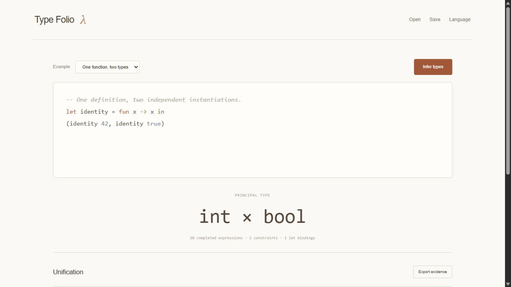
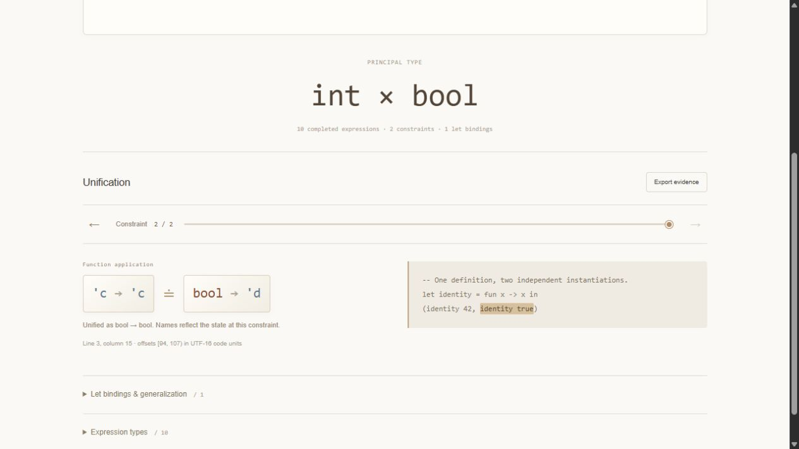

# Type Folio

An interactive Hindley–Milner type-inference workbench. Enter a small functional expression, inspect its principal type, step through unification constraints, and locate errors in the original source.



## Interface

The expression editor leads the page, followed by a prominent principal type and a compact unification trace. Syntax coloring is a read-only DOM overlay behind the native textarea; source text, selection, and editing remain native. The overlay uses text nodes rather than interpreting input as HTML. Let-binding and expression-type tables expand below the trace, and the language reference opens in a separate dialog.

Unification equations separate their left and right types and color primitive types, variables, and operators. Constraint changes and completed verdicts use brief transitions that respect reduced-motion preferences. The underlying type text and source spans remain unchanged.



## Run

Requires Python 3.10+. No runtime dependencies or API keys.

```sh
python run.py --port 8000
```

Open http://127.0.0.1:8000/. Inference runs in a cancellable browser worker. Source stays local; the app never evaluates or executes it. Save a folio before refreshing.

## Workflows

- Explore six studies covering let-polymorphism, composition, captured variables, conflicting branches, infinite types, and monomorphic lambda parameters.
- Edit an expression and infer its most general type.
- Step through equations and highlight the exact source expression behind each constraint.
- Jump back to the diagnostic after inspecting earlier reasoning.
- Inspect generalized binding schemes and final types of completed AST nodes.
- Save/reopen a folio or export complete analysis evidence, including source, spans, constraints, bindings, and typed nodes.

The [example folio](docs/example.json) infers `int × bool` from two independent uses of a let-bound identity function. The [line-ending fixture](docs/line-endings.json) contains Unicode in a comment and CRLF line endings. Imported source remains exact until a textarea edit, which may normalize line endings.

## Language

```text
let identity = fun x -> x in
(identity 42, identity true)
```

Supports integer and boolean literals, names, nonrecursive `let ... in`, single-argument `fun ... ->`, application, pairs, parentheses, and `if ... then ... else`. Curried functions use nested `fun` expressions. The polymorphic `fst` and `snd` prelude functions select pair components and may be shadowed.

Application binds most tightly, then `*`, then `+`/`-`, then `==`. Binary operators associate left. All arithmetic and equality operands must be integers; equality produces a boolean. Use parentheses around negative function arguments (`f (-1)`). `--` starts a line comment. Identifiers use ASCII letters/underscores followed by letters, underscores, or digits. Integers are typed without evaluating their values.

There is no recursion, mutation, evaluation, list/string type, subtyping, higher-rank polymorphism, or type-class overloading. A type is a static property, not a computed result.

## Inference

The engine uses mutable type-variable links with pruning, structural unification, and an occurs check. Each let-bound type is generalized over variables free in that type but not free in the current environment. Every use instantiates quantified variables freshly. Lambda parameters and captured environment variables remain monomorphic. Environment types observe substitutions through shared links before generalization.

Constraints record their types immediately before unification and the unified result at that time. A failure can leave partially constrained earlier nodes; the interface labels that evidence accordingly. Binding schemes are snapshots at generalization time, before checking the let body. Principal types and each binding scheme use local variable names; trace and expression-table names share an allocation history. Unquantified variables in a scheme represent captured environment variables. Pair and arrow displays preserve associativity with parentheses.

Source locations use half-open UTF-16 code-unit offsets, matching JavaScript and browser selection semantics. The parser produces exact spans and the UI renders source using text nodes, not HTML insertion.

The approach is based on [Damas and Milner, *Principal type-schemes for functional programs*, POPL 1982](https://doi.org/10.1145/582153.582176). This implementation is an educational subset, not a full ML compiler.

## Bounds and architecture

- Source: 12,000 UTF-16 code units; imported JSON: 100 KB.
- Lexer: 1,500 tokens; parser: 500 expression nodes and 80 nested expression calls.
- Inference: 100 recursive expression levels and 20,000 unification operations.
- Display formatting abbreviates type expansions after 160 visits using `…`; the underlying type graph remains complete.

`core.js` contains the lexer, parser, inference engine, and session validation. `worker.js` isolates computation. `app.js` handles editor invalidation, source inspection, imports, and exports. `run.py` serves only allowlisted static files on loopback, rejects unexpected Host headers, and sets a restrictive content security policy.

## Validation

Requires Node.js 22+ for JavaScript tests.

```sh
node --test
npm run check
python -m unittest discover -s tests -v
```

Fifteen core tests cover known principal types, fresh instantiation, captured-variable generalization, environment substitutions, direct/indirect occurs checks, shadowing, nonrecursive scope, projection schemes, precedence, exact spans, reporting, and resource limits. A deterministic generator checks 200 ground programs against a separate compositional type oracle. One HTTP test covers static assets, HEAD, hidden-file rejection, and Host validation. CI runs Ubuntu Node 22/24 and Windows Node 24.

Manual browser checks covered constraint stepping, source highlighting, infinite-type errors, captured-variable schemes, expression inspection, diagnostic navigation after an earlier successful constraint, and downloads. Independent Python checks verified exported default equations/spans and exact Unicode/CRLF session round-trip.

The expression-first redesign was browser-checked at desktop and 390-pixel widths, including syntax-overlay text/wrapping, constraint stepping, occurs-check diagnostics, custom source edits, and reference-dialog Escape. All fifteen inference tests pass.
